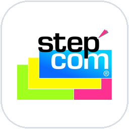
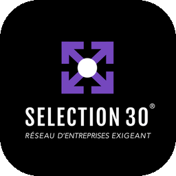
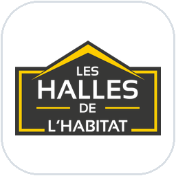
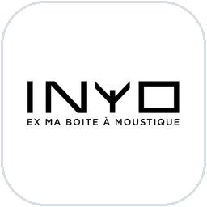
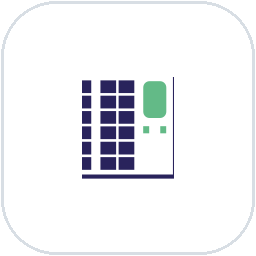

  

<h2 align="center">Hi, I'm Kévin 👋</h2>

  <strong>Mobile Flutter Developer · iOS & Android</strong> 
  Freelance under <a href="https://tisserak.fr">TisseraK</a> · Lyon, France 🇫🇷 · Open to Geneva 🇨🇭

  
  
  
  

---

I've been shipping Flutter apps since 2021, end to end: architecture, security, store publishing and long-term evolution. Today I also bring generative AI into the apps I build, without losing sight of what matters most: clean code and a smooth user experience.

**At a glance**

- 📱 **5 years** of production Flutter, iOS & Android, often as the sole or lead developer
- 🤖 **AI in production**: an AI assistant (Claude API) and image renders (Gemini) inside a live business app
- 📡 **Connected devices**: Bluetooth Low Energy control of IoT traps
- 🌍 **Remote & international**: clients in France, plus teams in India, the UK and Switzerland

### 🤝 Companies & apps I've worked with

  &nbsp;&nbsp;
  &nbsp;&nbsp;
  &nbsp;&nbsp;
  &nbsp;&nbsp;
  &nbsp;&nbsp;
  &nbsp;&nbsp;
  

### 💼 Experience

**Step'Com** · Lead Mobile Developer · Freelance 
Jan 2024 → today · Communication agency

 

Step'Com is a communication agency. I design and build the mobile apps of its clients, working directly with the founders and the agency's UX designer, from scoping to release.

 **SELECTION 30®** · *Business network · 2024 →*

A Flutter app that replaced the network's patchwork of tools with a single place for members and administrators.

- **Member & admin spaces**: each member gets an automatically created profile with their own stats and personalised data.
- **Real-time dashboards**: referrals, closed deals and key indicators for every member, updated live.
- **Meetings & attendance**: meeting management and attendance rate tracking, with the repetitive admin tasks automated.

 **Les Halles de l'Habitat** · *Business app & AI · 2025 →*

A business app for a home-renovation company, with generative AI built into the daily workflow.

- **Six user profiles** (business introducers, craftsmen, office staff, management, works managers…), with deal tracking by status and a full history.
- **Access rights enforced at the source**: every profile only sees its own data, and quotes stay confidential until management approves them.
- **"Emma", a conversational assistant**: Cloud Functions connected to the Claude API, API key kept server-side, data partitioned by profile, GDPR-compliant.
- **AI renovation renders**: a before/after render generated from a single photo (Gemini), plus a works cost estimator, both inside the app.
- **How we work**: scoping note, project split into priced batches, step-by-step development validated with the client, acceptance testing, then production release.

`Flutter` `Dart` `Firebase` `Cloud Functions (TypeScript)` `Node.js` `Claude API` `Gemini` `OneSignal`

**INYO** (ex-Ma Boîte à Moustiques) · Lead Mobile Developer · Freelance 
Jan 2022 → Jan 2026 · Connected mosquito traps

 

INYO makes connected mosquito traps. I took over the existing V1, then designed the V2 with the product team, both its technical foundations and its user experience.

**Client app**

- **Bluetooth Low Energy** communication with the traps: remote control, time-based scheduling, battery monitoring and notifications.

**After-sales app (mobile & web)**, *built from scratch*

An internal tool that gives the after-sales team everything it needs to diagnose a trap quickly.

- **Accounts**: management of client companies, their users and their access rights.
- **A detailed sheet for every trap**: serial number, board type, status, diffusion mode, remaining battery life, last sync.
- **Installed base at a glance**: a map of every installed trap, key statistics on the home screen and the full intervention history.

`Flutter (mobile & web)` `Dart` `BLE` `Firebase` `Firestore` `Maps`

**Le Casier Français** · Main Flutter Developer 
Nov 2021 → Apr 2026 · Connected lockers

 

Le Casier Français runs connected lockers. I was the sole owner of its iOS & Android app for four and a half years.

- **Full lifecycle**: requirements analysis, development, production releases, maintenance and incident fixes.
- **A BLoC architecture built to last**: it let the app keep evolving for the whole period without ever needing a rewrite.
- **Complete purchase flow**: catalogue, cart, Click & Collect and a map of pickup points.
- **Platform & delivery**: Firebase, REST API, push notifications, and every release published on the App Store and Google Play.

`Flutter` `Dart` `BLoC` `Firebase` `REST API` `Google Maps` `OneSignal` `Git`

**TisseraK** · Founder · Independent Mobile Developer 
Jul 2021 → today · My freelance studio

 

My own studio, through which I work with clients in France and abroad.

- **International projects**: remote collaboration in English with teams in India, the UK and Switzerland, on a mobile card game and a crypto app.
- **Engineering practices**: unit, widget & integration tests, CI/CD pipelines, OAuth 2.0, and AI-assisted development with Claude Code.
- **How I work**: requirements workshops, estimates, short sprints (Scrum, Kanban), regular progress updates, acceptance testing with the client, delivery, then maintenance.

`Unit, widget & integration tests` `CI/CD` `OAuth 2.0` `Scrum` `Kanban` `AI-assisted dev (Claude Code)`

**NewDayCare** · Mobile Developer · Apprenticeship 
Jan → Sep 2021

 

Sole developer on the project, which I owned end to end.

- **iOS & Android app** built in Flutter, from the first screen to release.
- **Firebase back end**: authentication, Firestore database and file storage.

`Flutter` `Dart` `Firebase`

### 🛠️ Tech stack

  
  
  
  
  
  
  
  
  
  

| | |
|---|---|
| 📱 **Mobile** | Flutter, Dart, BLoC, local storage, push notifications |
| 🔐 **Integration & security** | REST APIs, OAuth 2.0, tokens, roles & permissions, Firebase, Cloud Functions |
| ✅ **Quality & delivery** | Unit, widget & integration tests, CI/CD, Git, App Store & Google Play publishing |
| 🤖 **AI** | Claude API, Gemini, AI-assisted development with Claude Code |

### 📦 Open source projects

| Project | ⭐ Stars | 🍴 Forks | Status |
|---|---|---|---|
| [Flutter · Turismo App](https://github.com/TisseraK/turismo_app_FAN) |  |  | 👷 WIP |
| [Flutter · Pokédex](https://github.com/TisseraK/Pokedex_Flutter) |  |  | ✅ Done |
| [Flutter · CoinRule Concept App](https://github.com/TisseraK/coinrule_MobileApp) |  |  | ✅ Done |
| [Flutter · Tesla Concept App](https://github.com/TisseraK/TeslaApp) |  |  | ✅ Done |

### 🌍 Languages

🇫🇷 French (native) · 🇬🇧 English (fluent) · 🇩🇪 German (basics) · 🇯🇵 Japanese (learning)

### 📫 Let's talk

Got a Flutter project, an app to take over, or an AI feature to ship? Reach me at **[contact@tisserak.fr](mailto:contact@tisserak.fr)**.

  
  
  
  

